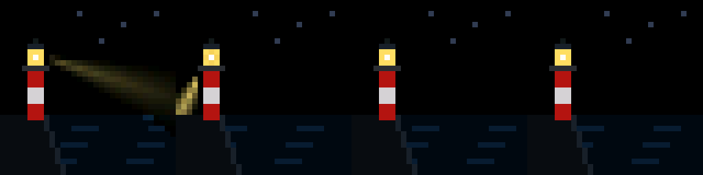
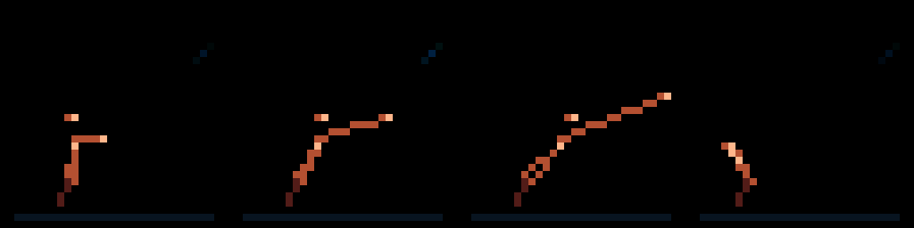

# Free model verification results

**Date:** November 6, 2026

**Model tested:** Gemini 3.8 Flash, model ID `gemini-3.8-flash`.

**Result:** Three final functions passed boundary checks, protected-source checks, the existing composition preview, and local ESP32 compilation after model corrections. This demonstrates a usable manual prototype path. Free API access and per-project quotas still require a project/credential check, and creative quality requires the user's review before selecting the model for automation.

## Cost controls and account observations

- Used Google AI Studio's playground with **No API key selected**. No paid key was selected or linked.
- Grounding with Search and Maps, code execution, function calling, URL context, and structured outputs were off for the tests.
- No billing account, payment method, paid tier, upgrade, or paid hosting was enabled. No API key or Cloud project was created.
- AI Studio's Projects and API Keys pages showed no imported projects or keys. This does not establish that the Google account has no other Cloud resources.
- Google's published pricing lists standard Gemini 3.8 Flash input and output in the free tier. Actual API eligibility and quotas for this account are not yet verified. [Pricing](https://ai.google.dev/gemini-api/docs/pricing).
- Google's billing guidance distinguishes free playground use from use through a paid key. These tests used the unkeyed playground; they are not an API billing test. [Billing](https://ai.google.dev/gemini-api/docs/billing).
- All compilation and preview rendering ran locally using already installed tools. No cloud build jobs were started.
- The only submitted material was the generic generation brief, creative test prompts, and code-correction feedback. The Wi-Fi password and live project files were not uploaded.

## Technical results

| Prompt | Corrections requested | Final validation | Preview | ESP32 compilation | Firmware binary |
| --- | --- | --- | --- | --- | --- |
| Lighthouse over a dark sea | 1 | Passed | Generated and inspected | Passed | 292,384 bytes |
| Overflowing heart | 1 | Passed | Generated and inspected | Passed | 292,064 bytes |
| Vulnerable figure reaching, waiting, bracing | 2 | Passed | Generated and inspected | Passed | 290,544 bytes |

The original attempts were retained. None was accepted unchanged: the lighthouse download was incomplete, the figure's first completed UI response had no function, and code review found unsigned-offset arithmetic in the heart and unbounded floating-point time in the figure. Corrections were requested from the same model; the assistant did not manually rewrite the final C++ functions.

Initial attempts used Medium thinking. Correction attempts used Low thinking. These three examples are a small feasibility sample, not a reliability benchmark or proof that future outputs will be valid.

## Preview review

Each contact sheet shows approximately 100, 1000, 3000, and 6000 ms from left to right. These are simplified desktop drawing previews. They do not reproduce ESP32 execution speed, exact Adafruit rasterization, LED glow, or a video of the physical board.

### Lighthouse

Recognizable tower and sea, but the beam is dim and disappears in most sampled frames. Muted scenery departs from the bold, saturated brief. Human creative approval pending.

### Overflowing heart

Readable saturated heart with a pulse and outward particles against black space. Strongest match in this small sample. Human creative approval pending.

### Vulnerable figure

Reaching, waiting, and bracing are visible, and the mood remains unresolved. Thin strokes and a tiny head may be weak on the physical panel. Human creative approval pending.

## Build and source checks

The existing helper was copied into the isolated verification workspace and used for function parsing, protected-byte comparison, and compilation. The original preview helper and its drawing mock were reused. The baseline source was captured before tests; the original live sketch still has the same SHA-256 at the end of the checks.

Each candidate replaced only `restState` in an isolated copy. Compilation used installed ESP32 core 2.0.17 and the archived full board options. The test helper's build cache is separate from the Arduino IDE cache. No board upload, serial operation, or firmware deployment was performed.

The local firmware binaries are below the configured 1,310,720-byte application slot. These scene-only builds do not establish the size or runtime memory of a future Wi-Fi/HTTPS/OTA build.

## Files retained

The experiment directory is `experiments/model-verification/2026-11-06/`.

Each scene folder contains its exact creative prompt, full generation brief, final downloaded `candidate.cpp`, correction prompts, earlier rejected outputs where available, composed sketch, preview, compile log, firmware, and `verification-results.json`. The top-level `verification.json` records model settings, baseline hash, account observations, and outstanding checks. The local compiler cache is excluded from Git tracking.

Google Drive chat saving was not enabled. Downloaded source files provide the local record of the generated code.

## Remaining decisions

- [ ] User reviews the three previews and decides whether the creative results are acceptable for further prototyping. The model has not been selected for unattended operation.
- [x] User explicitly approved creating the no-billing `lightboard-prompter` project and Gemini API key, storing the credential outside Git and enabling no paid services.
- [ ] Resolve the project-creation blocker: AI Studio rejected the approved request in the current SVA account with “Project creation is disabled. Please try again later.” No project or key was created. Await the user's choice to try a personal Google account or resolve access in SVA, then verify free-tier status and actual quotas before API use.
- [ ] Test physical frame timing, image quality, and networking later in the controlled hardware stage.

## Approved API setup attempt

The user approved the free project/key setup on November 6. Submitted project name `lightboard-prompter` through AI Studio's new-project dialog. Google returned: “Failed to create project, Project creation is disabled. Please try again later.” The Projects list still had no imported project rows.

The error does not establish the cause. No payment, billing upgrade, permission expansion, project import, or alternate-account login was attempted. No API key exists from this attempt, so no credential file was created. The account decision is pending user input.
